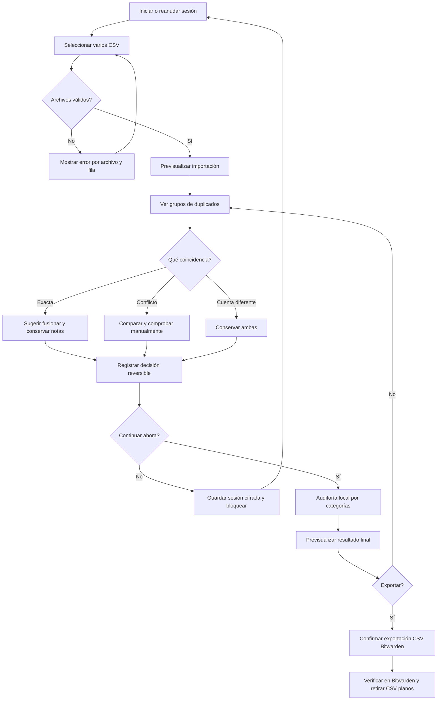

# Password Checker — Estudio de flujo de usuario y plan de validación

> **Análisis de recorrido v0.1 · 29 de octubre de 2026 · Hipótesis por validar.**
>
> Es un **walkthrough de una persona representativa y de condiciones reales de uso**, fundamentado en las necesidades expuestas durante el diseño. **No se han realizado entrevistas, sesiones observadas ni pruebas con usuarios reales**. Las hipótesis y los criterios de éxito se verificarán antes de dar por cerrada la UX.
>
> Complemento: [Guía visual móvil y escritorio](guia-visual.md).

## 1. Trabajo que el usuario necesita completar

> «Tengo contraseñas guardadas en varios navegadores y dispositivos. Quiero importar todas a un único gestor, sin perder cuentas, sin duplicados inútiles y sin pasar semanas comprobándolas. Necesito saber qué queda pendiente y poder continuar otro día».

**Contexto:** Windows/Linux con Chrome, Brave y Firefox; teléfono Android; cientos de entradas; exportaciones CSV con distintas cabeceras, notas, registros de aplicaciones Android y credenciales que pueden estar desactualizadas. El usuario no quiere subir contraseñas a servicios externos. La migración no se resolverá en una única sesión.

**Objetivos reales:**

1. Detectar **antes de borrar** qué registros son idénticos y cuáles podrían representar cuentas distintas.
2. Resolver ambigüedades utilizando un enlace de prueba **a petición del usuario**.
3. Ver las contraseñas solo cuando resulte necesario y guardar avances entre días.
4. Exportar una sola vez a Bitwarden con el mejor dato disponible, conservando un respaldo seguro hasta confirmar la migración.

**Antimetas:** mostrar contraseñas en masa, asumir que una contraseña es válida por ser la más reciente, tratar todos los servicios localhost como uno, convertir automáticamente contraseñas reutilizadas en duplicados, o afirmar «sin brechas» sin comprobación externa.

## 2. Viaje completo (de principio a fin)

| Fase | Acción del usuario | Lo que muestra la interfaz | Riesgo o fricción | Comportamiento necesario |
|---|---|---|---|---|
| A. Preparar | Exporta CSV desde 3 navegadores | Instrucciones con advertencia de texto plano | Exportar varias veces la misma cuenta | Permitimos múltiples archivos y mostramos procedencia |
| B. Importar | Arrastra o selecciona archivos | Vista previa por fuente, conteos, cabeceras, errores | CSV con comas en nombre/nota; Firefox sin `name` | Normalizar y mostrar avisos; nunca mover contraseña silenciosamente |
| C. Explorar | Entra en Duplicados | Grupos pendientes y por qué coinciden | 500 filas sin jerarquía | Grupos de URL+usuario, contadores y filtros |
| D. Comparar | Abre un grupo conflictivo | A/B con usuario visible y contraseñas ocultas | Recuerda mal cuál era la nueva | Mostrar procedencia, notas y enlace; no elegir automáticamente |
| E. Probar | Abre web en pestaña nueva | Regresa sin perder scroll y edición | Link localhost no disponible en móvil | Enlaces http(s) seguros; aviso de localhost móvil |
| F. Decidir | Conserva A/B/ambas o excluye | Vista previa de resultado y opción deshacer | Eliminación accidental | Cambios reversibles; originales inmutables |
| G. Pausar | Guarda sesión cifrada | Progreso y botón Continuar | Puede tardar varios días | Recuperar estado, filtros, ediciones y pendientes |
| H. Auditar | Revisa grupos de reutilización/debilidad | Categorías desplegables | Confundir revisión con corrección | Estados de revisión/seguridad separados |
| I. Exportar | Ve resumen y confirma | N.º incluidas/excluidas, conflictos, notas preservadas | Importar duplicados o perder cuentas | Previsualizar; confirmar; CSV de Bitwarden sin sobrescrituras |
| J. Cerrar | Comprueba en Bitwarden | Checklist postimportación | Borrar originales demasiado pronto | Conservar respaldo seguro hasta verificar cuentas críticas |

## 3. Escenario detallado 1 — El primer día, en el PC

**Situación plausible:** se cargan tres CSV de distinto navegador; muchos registros coinciden, otros difieren por contraseña o por ruta. La persona dispone de **20 minutos**, no de una tarde.

1. Abre la aplicación. Ve que está operando en local y que las contraseñas están ocultas.
2. Selecciona 3 archivos con el botón o los arrastra. El sistema indica `3 archivos · N registros`; identifica Firefox por su cabecera. Si falla una fila, dice exactamente cuál, **sin imprimir su valor**.
3. Llega directamente a **Duplicados**, no a una tabla de cientos de registros. Orden: conflictos sin revisar, duplicados exactos sugeridos, posibles relacionados.
4. Abre un grupo; los campos coincidentes tienen etiquetas «Coincide», el conflicto explica «Misma URL y usuario; contraseñas diferentes».
5. Pulsa **Abrir web**: pestaña nueva, la herramienta conserva selección y scroll. Inicia sesión manualmente, vuelve y marca «Acceso verificado» en la variante correcta.
6. Decide qué conservar; se ve un resumen reversible. Si hay notas distintas, se presentan antes de fusionar.
7. Debe salir. Pulsa **Guardar sesión cifrada** y cierra. En la próxima visita aparece «Continuar: N grupos pendientes».

**Fricciones previsibles:** autocompletado del navegador interfiere con la comprobación; un sitio puede usar varias rutas legítimas; no es posible probar un sistema apagado; el usuario puede querer descartar un login antiguo sin borrarlo del origen.

**Soluciones:** sin auto-check ni automatización de logins; clasificación «No puedo verificar ahora»; no obligar a resolver todos los conflictos para **guardar sesión**; exportación con advertencia de conflictos pendientes y decisión explícita de conservar variantes.

## 4. Escenario detallado 2 — Día siguiente, desde Android

1. Conecta el móvil por USB a la máquina local (ruta inicial de acceso segura propuesta, no implementada).
2. Recupera su sesión; en **Continuar revisión** filtra `Aplicaciones Android` y `Pendientes`.
3. Abre ficha de app. El paquete aparece identificable; la URI Android **no** se presenta como enlace web.
4. Si hay mecanismo de apertura verificado para esa app, aparece una acción explícita; si no, búsqueda en tienda y opción de comprobar manualmente desde el lanzador del móvil.
5. Vuelve al navegador y registra «Verificada» o «No funciona». Si modificó contraseña/usuario, se reinicia el estado de verificación y queda historial del cambio.
6. Guarda la sesión cifrada; desde el PC el siguiente día sigue donde lo dejó.

**Puntos difíciles:** una app puede no estar instalada, no ofrecer deep link, requerir 2FA, o no recordar el formulario anterior. Una dirección `127.0.0.1` desde el móvil apunta al **móvil**, no al PC: avisar, no abrir como si fuera el servidor del ordenador.

## 5. Escenario detallado 3 — Reutilización no es duplicado

La aplicación detecta la misma contraseña en dos cuentas web y una de desarrollo local. En **Auditoría → Reutilizadas** aparecen agrupadas bajo «3 cuentas usan la misma contraseña» **sin mostrar la contraseña**.

- No se fusionan ni excluyen: son cuentas distintas.
- Se permite marcar una excepción («Cuenta de pruebas / pendiente de cambio»), pero el hallazgo **sigue existiendo**, con estado «Excepción consciente».
- En localhost se distinguen puerto y protocolo en identidad. Una recomendación para cuenta crítica es diferente de la de laboratorio local; no declarar un sitio seguro solo porque se llame `localhost`.
- Un cambio de contraseña dentro de Password Checker **no significa que cambió la contraseña del servicio**: la interfaz advierte «Modificas el registro de exportación, no la contraseña de la cuenta». Para corregir un riesgo, el usuario debe cambiarla en el servicio y luego actualizar el dato.

## 6. Casos límite que deben quedar resueltos en diseño

| Caso | Resultado esperado |
|---|---|
| Dos filas idénticas salvo notas | Sugerir fusión conservando ambas notas; mostrar diferencias |
| Misma URL, mismo usuario, contraseñas distintas | Conflicto, **ninguna eliminación automática** |
| Misma URL, usuarios distintos | Dos cuentas; no duplicado |
| Mismo usuario y contraseña en webs diferentes | Reutilización en auditoría; no duplicado |
| `http://127.0.0.1:8000` vs `https://127.0.0.1:8000` | Registros diferentes; mostrar posible relación sin fusión automática |
| `127.0.0.1:8000` vs `127.0.0.1:8020` | Instancias distintas por puerto |
| `android://FIRMA@paquete/` | Identificar app y conservar URI original; conversión explícita para exportación |
| Registro Android y web de un mismo proveedor | Posibles relacionados, no deduplicar solo por nombre |
| URL con query sensible o `usuario:clave@host` | Advertencia, no abrir automáticamente, nunca copiar secretos al informe |
| CSV con comas entrecomilladas | Leer correctamente |
| CSV con columnas desplazadas | Detener/avisar; solo reparar bajo criterio verificable y revisión |
| Contraseña revelada al cambiar de pantalla | Ocultar de nuevo; no persistir estado «visible» |
| Usuario cambia contraseña en editor | Recalcular duplicados, reutilización y seguridad; invalidar estado de acceso verificado |
| Usuario modifica únicamente nota | Mantener estado de verificación |
| Cierre del navegador o apagado | Sin sesión guardada: advertir riesgo de perder progreso; con sesión cifrada: reanudar |
| Exportación con conflictos pendientes | Previsualizar y explicar qué variantes se conservarán; solicitar confirmación |
| Importación repetida en Bitwarden | Advertir que Bitwarden puede crear duplicados; indicar flujo de una sola importación |

## 7. Decisiones de producto: modelos separados

**Registro de origen (inmutable):** archivo/fuente, línea original, nombre, URL original, usuario, contraseña, notas y metadatos disponibles.

**Candidato exportable (editable):** nombre, URI para Bitwarden, usuario, contraseña, notas, incluir/excluir; enlaza a uno o más registros de origen.

**Revisión:** pendiente/revisada/verificada/incorrecta, nota de revisión opcional y fecha declarativa; se refiere al candidato o cuenta. **Seguridad:** alertas recalculadas y su estado de resolución o excepción. **Grupo de comparación:** coincidencias, decisión, motivo, si está pendiente.

No mezclar estas entidades en un único booleano `checked`; permitir que una credencial esté verificada pero siga teniendo contraseña reutilizada. Los identificadores deben ser estables dentro de la sesión aun cuando el usuario reordene o filtre.

## 8. Validación de usabilidad con personas (pendiente de realizar)

No presentar los tiempos siguientes como resultados medidos: son **metas para un estudio futuro** con datos sintéticos.

**Participantes propuestos:** 4–6 personas de diferente soltura digital; al menos una alternando PC/Android y una utilizando teclado sin ratón. Se prueban **credenciales y sitios ficticios** (nunca CSV reales).

| Tarea a observar | Criterio de éxito propuesto | Qué registrar |
|---|---|---|
| Importar 3 CSV con formatos distintos | Completar sin pedir instrucciones externas | Errores, tiempo, confusión de campos |
| Distinguir duplicado exacto de contraseña reutilizada | Clasificación correcta y sin excluir cuentas distintas | Falsas fusiones, explicación dada por participante |
| Resolver conflicto de misma URL/usuario | Elegir conservar las dos si no puede verificar, sin perder información | Confianza, errores destructivos, uso de enlace |
| Mostrar y volver a ocultar una contraseña | Encuentra el ojo y entiende privacidad inicial | Exposición involuntaria y tiempo visible |
| Pausar y recuperar revisión desde otro día | Reanuda con edición/estado correctos | Datos perdidos, estado recordado, mensajes confusos |
| Revisar una app Android en teléfono | Comprende que no es enlace web y cómo verificar manualmente | Intentos fallidos, retorno a ficha |
| Exportar cuando hay conflictos pendientes | Comprende exactamente qué se exporta | Errores de exclusión, decisión consciente |

**Objetivos propuestos (ajustables):** cero pérdidas de credenciales por acciones implícitas; 100 % de participantes distinguen «revisada» de «verificada» después de una explicación breve en interfaz; tareas principales realizables sin revelar contraseñas en masa; navegación completa por teclado. Medir tasa de éxito y errores, no solo tiempo.

**Guion de observación:** evitar guiar al participante; pedir que explique qué cree que pasará al pulsar un botón; observar dónde se detiene; después preguntar qué información le faltó, qué acción le dio miedo y qué palabra resultó ambigua. Iterar prototipo y repetir tareas.

## 9. Dependencias y orden recomendado

1. Aprobación de arquitectura de información y guía de estilo.
2. Prototipo estático para 1440 px y 390 px con **datos sintéticos**, validación de lectura y navegación.
3. Diseño de modelo de datos y estados de revisión (origen inmutable / candidato / sesión).
4. Revisión de seguridad de arquitectura local y persistencia cifrada.
5. Conectar motor CSV actual a la UI y añadir pruebas de no pérdida y regresión.
6. Piloto UX con tareas anteriores, refinar antes de importación real.

## 10. Decisiones todavía abiertas

- ¿Qué mecanismo y política exactos tendrá la sesión cifrada (bloqueo automático, recuperación, gestión de frase de paso)? **Requiere análisis de seguridad antes de implementar.**
- ¿Se debe exigir resolución de un conflicto antes de exportar, o permitir exportar las dos variantes con confirmación? Propuesta: permitir ambas con aviso.
- ¿Qué alcance tendrá «Abrir aplicación» en Android? Propuesta: no prometer apertura hasta comprobar compatibilidad concreta.
- ¿Es más conveniente una tabla editable por teclado o panel contextual de edición para la primera versión? Propuesta: **panel contextual** para minimizar errores.

**Conclusión:** el mayor riesgo UX no es «encontrar un duplicado», sino **tomar una decisión irreversible sin comprender qué datos se perderán**. La interfaz se diseña para comparar primero, decidir después, y exportar solo cuando la vista previa explique claramente las consecuencias.